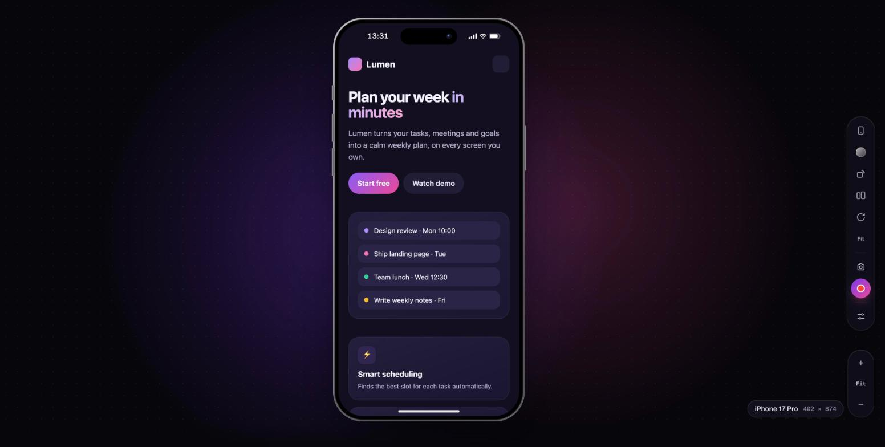
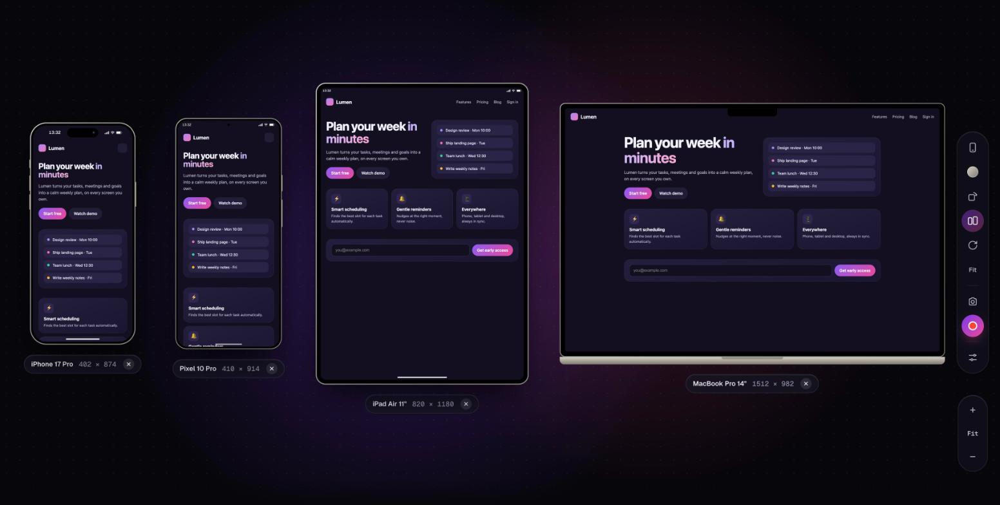
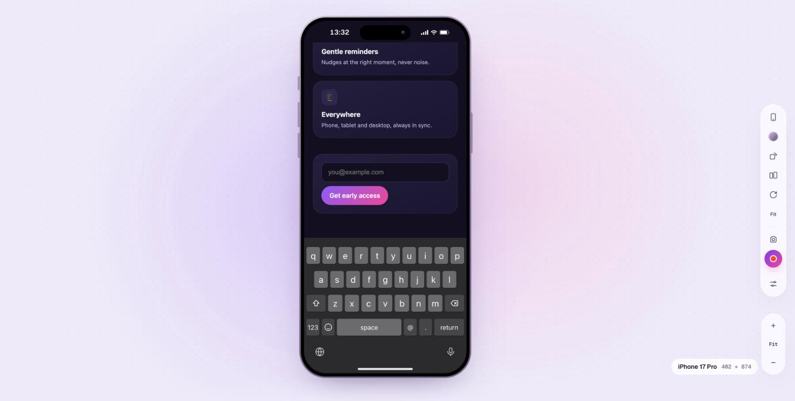

# jhm-web-responsive

A free Chrome extension to preview any website in realistic phone, tablet and desktop frames: test responsive layouts, take beautiful screenshots and record videos. No account, no tracking, nothing locked behind a paywall.

| Compare devices | Phone keyboard |
|---|---|
|  |  |

Screenshots use a demo website.

## Features

- **Side panel**: the website stays in your tab, the phone preview sits next to it and follows the tab you're on.
- **Scroll sync**: scroll the website, the phone follows (and the other way round). By percentage or by section.
- **Full screen**: an immersive simulator over the page, with a toolbar you can place on any side.
- **Devices**: recent iPhones, Android phones, iPads and Android tablets, MacBook / Windows laptop / desktop monitor, plus your own custom sizes.
- **Realistic frames**: Dynamic Island (with animations), notch, punch-hole, home button, side buttons, status bar that takes the site's colour, 20+ frame finishes or your own gradient.
- **Compare**: 2 to 5 devices side by side; a page opened in one opens in all.
- **Phone keyboard**: tap a field and an iOS, Gboard or iPad keyboard slides up, adapting to the field type (email, number, URL, search…). The page shrinks above it like on a real phone.
- **Screenshots**: export as PNG, JPEG or WebP with gradient backgrounds, padding, shadow, sizes for social media (1:1, 9:16, 4:5, 16:9) and a caption (Elegant or Script font, adjustable opacity, optional extension-icon watermark).
- **Video recording**: MP4 with a 3-second countdown, microphone, three quality levels and a review screen before saving. No sharing prompt when started from the extension.
- **Zoom & rotation**: smooth zoom (map-style + / Fit / −) and rotation.
- **Mobile identity**: sites receive a real phone browser identity, so they serve their mobile version.

## Install

The extension isn't on the Chrome Web Store yet. Install it in developer mode (it takes a minute):

1. **Download the code**
   - Click the green **Code** button on this page → **Download ZIP**, then unzip it, **or**
   - clone it: `git clone https://github.com/jhmesseroux/mobile-simulator-extension.git`
2. Open Chrome and go to **`chrome://extensions`**.
3. Turn on **Developer mode** (switch in the top-right corner).
4. Click **Load unpacked** and select the `mobile-simulator-extension` folder (the one containing `manifest.json`).
5. Click the puzzle icon in Chrome's toolbar and **pin** jhm-web-responsive so its icon is always visible.

Works in Chrome and other Chromium browsers (Brave, Edge, Arc) recent enough to support the side panel (Chrome 116+).

### Update

- If you downloaded the ZIP: download it again and replace the folder.
- If you cloned it: run `git pull` in the folder.

Then open `chrome://extensions` and click the **reload** arrow on jhm-web-responsive.

## Use

| To… | Do this |
|---|---|
| Open the side panel | Click the extension icon, or press **Alt+Shift+M** |
| Open full screen on the page | Right-click the icon → **Open full screen**, press **Alt+Shift+F**, or use the full-screen button in the side panel |
| Simulate a link in a new tab | Right-click a link → **Open link in jhm-web-responsive** |
| Leave full screen | **×** in the top-right corner, or **Esc** |
| Move the side panel left / right | The left/right button in the panel opens Chrome's setting (it's Chrome-wide) |

### Shortcuts (in the simulator)

| Key | Action |
|---|---|
| `D` | Devices |
| `R` | Rotate |
| `C` | Compare devices |
| `S` | Screenshot |
| `V` | Record / stop |
| `+` `−` `0` | Zoom in / out / fit |
| `⌘R` / `F5` | Reload the page in the phone only |
| `Esc` | Close menus, dialogs, full screen |

Shortcuts for opening the extension can be changed in `chrome://extensions/shortcuts`.

### Inline phone (for testing tools)

Automation tools such as Claude in Chrome can't open extension pages, see the side panel or keep an extension's frame in a page. The inline phone is drawn **inside the website's own page** instead: the page stays live on the left, the phone is docked on the right (or fills the window).

- Open it by adding `#mobile-sim` to the address, or `#mobile-sim=<device>,<portrait|landscape>,<dock|full>` (e.g. `#mobile-sim=pixel-10-pro,landscape,full`); `#mobile-sim=off` closes it. Pages can also send `window.postMessage({ __mobileSimPage: 'open', device: 'iphone-se' }, '*')` (or `'close'`), which suits apps whose router uses the hash.
- Or right-click the extension icon, or the page itself: **Open inline phone**, **Inline phone: screenshot**, **Inline phone: record a video** (no share prompt from the menu), and **Inline phone options** → *Open full window*, *Close*, *Settings…*. On a site that isn't allowed yet, this adds it (you asked for it) and says so on the page.
- Only on **allowed sites**: by default `localhost`, `127.0.0.1`, `*.localhost` and `*.test`. Change the list, or turn the inline phone off, in Settings → Inline phone. Using `#mobile-sim` on another site shows a short notice with an **Allow <site>** button: one click adds the site and opens the phone (the button ignores clicks made by the page's own scripts).
- Inside the phone the page sees the device width, a mobile user agent and client hints, `navigator.maxTouchPoints` and touch support. CSS `hover` / `pointer` media queries still report a mouse.
- State for scripts: `<html data-mobile-sim="loading | ready | blocked:framing | blocked:frame-busting | not-allowed | off">`, the phone's position in `data-mobile-sim-screen` (`x,y,width,height`), and the page inside the phone at `document.querySelector('mobile-sim-host').shadowRoot.querySelector('#mobile-sim-screen')` (same origin).
- The phone's bar: device, dock/full window, **screenshot**, **⋮ More** and **settings**. The background follows the site's light or dark look (Auto) or is forced Light / Dark from More. Drag the panel's left edge to resize it (double-click to reset).
- Side-by-side, the page beside the phone stays responsive: its CSS breakpoints, `vw` lengths and right-anchored fixed elements follow the space left of the panel, not the whole window (`lib/page-fit.js`). Limits: stylesheets from another origin (e.g. a CDN) can't be read, and breakpoints computed in JavaScript (`innerWidth`, `matchMedia`) still see the whole window.
- Screenshots are captured at high density (2× on Retina screens, in one shot inside the panel; 3× on 1× screens, tile by tile) and composed like the simulator's: your saved background, padding, shadow, caption and frame. Files are saved quietly with a small toast (*Show in folder*).
- The simulator's side panel and full screen have an **Inline phone** button: same device and orientation, on the same tab.
- **⋮ More**: background (Auto / Light / Dark), rotate, record a video, open the full-screen simulator or the side panel instead (no prompt when Chrome allows tab capture, else Chrome's "share this tab" prompt, cropped to the phone), address bar, status bar, home indicator, scroll sync with the page, screenshot watermark, frame colour.
- Esc or ✕ closes it; it comes back after a reload of the page until closed. A page that breaks out of frames (`top.location = …`) can't be shown and reports `blocked:frame-busting`.
- Test harness: `python3 test/page-mode/server.py` (see `test/page-mode/README.md`).

## Permissions

| Permission | Why |
|---|---|
| Read and change data on websites | Let sites load inside the phone frame and receive a mobile identity, only in the simulator's own tab or panel, or in a page-mode tab on a site you allow (that site only, the phone's frame only) |
| Side panel | Show the simulator next to the website |
| Tab capture | Record videos of the simulator without a sharing prompt |
| Scripting | Show the full-screen simulator over the page; in the inline phone, give the phone's page its mobile identity on allowed sites |
| Tabs, web navigation | Follow the active tab, restore full screen after a page refresh |
| Storage | Remember your settings |
| Downloads (+ downloads UI) | The inline phone saves screenshots and videos quietly, with its own "Saved · Show in folder" toast instead of Chrome's download bubble |
| Context menus | Right-click entries |
| Clipboard write | "Copy" in the screenshot dialog |
| Favicon | Show site icons in the Dynamic Island |

## Privacy

Everything runs in your browser. The extension has no server, no account and no analytics; screenshots and videos are saved only where you choose.

## Known limits

- Some sites refuse to run inside another page (e.g. some sign-in or banking pages).
- In the side panel, full screen and new-tab simulator the site runs in a frame of the extension, which Chrome partitions (separate cookies and storage): you may appear logged out. The **inline phone** runs inside the site's own page and keeps your session — it is what the extension icon opens by default (Settings → "The extension icon opens").
- It shows the layout at real device sizes, not every browser-engine difference (e.g. Safari-only bugs).
- After a page refresh in full screen, Chrome may ask once before recording; use the icon menu or Alt+Shift+F again to avoid it.

## Project structure

- `manifest.json`: extension configuration
- `background.js`: icon, side panel, right-click menu, full screen over a page, rule cleanup
- `simulator.html` / `simulator.css` / `simulator.js`: the simulator (side panel, full screen and new tab)
- `frame.js`: runs inside previewed pages (touch scrolling, keyboard, scroll sync) and starts the inline phone
- `lib/`: devices and frames, header rules, screenshot/video look, recorder, keyboards, inline phone (`page-mode.js`, `page-mode-settings.js`, `identity.js`), shared phone drawing (`device-view.js`, `device-frame.css`)
- `test/page-mode/`: local harness for the inline phone
- `vendor/mp4-muxer.mjs`: [mp4-muxer](https://github.com/Vanilagy/mp4-muxer) (MIT)
- `SPEC.md`: detailed feature specification and history

Plain JavaScript, no build step: edit the files and reload the extension.
